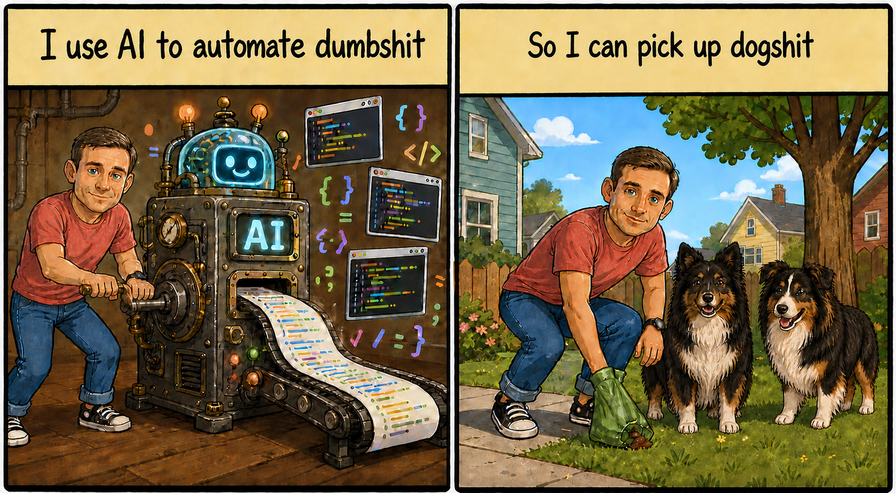

I'm a Software Engineer at [OpenAI](https://openai.com). 

I'm building [web.runme.dev](https://web.runme.dev) and using Codex to get my heartbeats back so I can spend them doing the things that truly matter.

::: {.homepage-cartoon .column-page}
{fig-alt="A two-panel cartoon. In the first panel, Jeremy turns a crank on an AI machine that produces code beneath the title 'I use AI to automate dumbshit.' In the second, he picks up after his two dogs beneath the title 'So I can pick up dogshit.'"}
:::

## Where to Go Next 
* Check out [web.runme.dev](https://web.runme.dev); [github.com/runmedev/web](https://github.com/runmedev/web)
* Connect with me on Blueksy [jeremy.lewi.us](https://bsky.app/profile/jeremy.lewi.us)
* Read [How I use AI to automate my job at OpenAI](https://developers.openai.com/blog/automating-repetitive-work-at-openai-with-codex)
* Check out [About Me](about) to learn more about my career and expertise
* The [OSS](oss) page is a collection of open source projects I've been involved with
* [My notes](notes) pages contain my personal notes about various technologies I work with 
